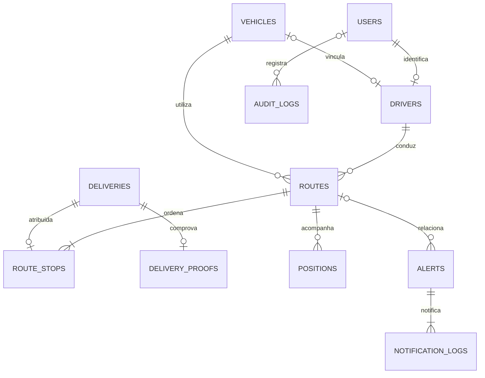

# Arquitetura e modelo relacional

## Decisão técnica

PHP 8.2 nativo, front controller com allowlist, PDO MySQL e serviços de domínio. Sem framework/ORM para manter a instalação adequada ao laboratório XAMPP. A view é sempre PHP e pode incluir componentes e sessão; ela não abre conexão ou concentra regras de negócio. Os ativos CSS/JS ficam separados para cache futuro e CSP sem script inline. Um único banco representa uma transportadora (não há multiempresa).

## Relacionamentos

Outras FKs: entregas/rotas guardam criador; posições guardam usuário que enviou; POD guarda motorista; alerta guarda resolvedor. Identificadores são BIGINT UNSIGNED. UNIQUE de placa/e-mail/CNH e `route_stops.delivery_id` previnem duplicatas. Pesos/volumes/custos são DECIMAL; o algoritmo converte para float só no cálculo da heurística. Banco impõe mínimos e coordenadas válidas. PII não deve entrar na tabela de auditoria.

## Estados e transações

Pedido: `pendente → planejada → a_caminho → entregue | falha`.

Rota: `planejada → em_andamento → concluida`.

Atribuição da rota bloqueia veículo, motorista e pedidos em transação; cria rota e paradas e reserva recursos. Início verifica CNH/manutenção novamente. O motorista deve registrar POD ou falha para todas as entregas antes de concluir a rota. Conclusão libera veículo e disponibilidade. Uma rota planejada também reserva o veículo com status `em_rota`; dashboard inclui essas reservas na ocupação.

POD bloqueia rota e pedido, verifica vínculo e código, insere comprovante único e atualiza entrega atomicamente. Timestamp é do banco. Código não é gravado no comprovante e seu hash é eliminado após sucesso. Cadastro CSV usa uma transação para todo lote: uma linha inválida desfaz todas.

Sem cancelamento/replanejamento/reatribuição ou nova tentativa na mesma referência nesta versão; uma entrega falha permanece como ocorrência encerrada. 

## Matriz de autorização

| Ação | Admin | Gestor | Despachante | Motorista |
|---|---|---|---|---|
| Cadastro público de conta própria | disponível sem autenticação; escolha Gestor, Despachante ou Motorista; sem admin ||||
| Criar contas operacionais / atribuir função | sim | não | não | não |
| Cadastrar frota/motoristas/manutenção | sim | sim | não | não |
| Criar/importar pedidos e planejar rotas | sim | sim | sim | não |
| Dashboard/rastreamento/Helper | global | global | global | somente próprios |
| Previsão/risco/análise/alertas/exportação | sim | sim | sim | não |
| Iniciar/concluir rota, POD e GPS | não | não | não | somente próprios |
| Anonimização e backup CLI | operador autorizado do servidor, fora da interface web ||||

A checagem ocorre no início dos endpoints e nas consultas de propriedade. Esconder links não é controle de segurança. A CLI exige acesso ao servidor e às credenciais; não deve ser exposta via HTTP.

## Contratos HTTP

Base: `/index.php?page=...`. GET lê; POST modifica; ações inválidas retornam 405. POST exige campo `csrf` ou header `X-CSRF-Token`, cookie de sessão e perfil adequado. Endpoints JSON esperam `Accept: application/json`.

| Endpoint | Método | Dados |
|---|---|---|
| `login` | POST | email, password, role, csrf; perfil selecionado conferido no banco |
| `register` | GET/POST | name, email, password, password_confirmation, privacy, role, csrf; cria conta ativa somente como Gestor, Despachante ou Motorista |
| `setup` | GET/POST | dados de conta; apenas localhost em APP_ENV=local e sem admin existente |
| `users`, `vehicles`, `drivers`, `deliveries`, `routes` | GET/POST | formulário da respectiva view |
| `tracking-data` | GET | route, driver, region opcionais; retorna deliveries e positions |
| `position` | POST | route_id, lat, lng; somente motorista da rota |
| `driver` | POST | action=start/pod/fail/finish; route_id; delivery_id/code/GPS para POD |
| `chat` | POST | question; não envia texto livre para IA externa |
| `analysis` | POST | solicitação autenticada; métricas calculadas no servidor |
| `resolve` | POST | id do alerta |
| `export`, `report` | GET | from/to em AAAA-MM-DD |
| `logout` | POST | csrf |

JSON: 401 sem sessão, 403 sem permissão, 419 CSRF, 422 validação, 429 limite de IA. Erros internos retornam referência sem detalhe técnico. As páginas de formulário usam Post/Redirect/Get com mensagem flash. Duplicatas são tratadas sem exposição do erro SQL.

## Métricas, fallback e expansão

Nenhum mapa, IA ou SMTP é necessário para salvar pedidos, planejar rotas, registrar código POD ou listar dados. GPS depende do dispositivo; POD exige coordenadas e não inventa localização no modo offline. Falta de banco é indisponibilidade real, sem dados falsos. O sistema não sincroniza operações offline nem grava entregas sem conexão.

Previsão usa sazonalidade/tendência com backtest e risco usa regressão logística local com avaliação temporal e ajustes operacionais. Gemini amplia narrativa e Helper; fallback consulta dados autorizados localmente. Mapas usam tiles externos e linhas aproximadas. Gráficos de barras nativos (`meter`) e tabelas são acessíveis sem CDN. O monitor é agendado via CLI; sem agendador, não há alertas automáticos novos.

## Administrador único

A coluna gerada users.admin_singleton e seu índice UNIQUE impedem dois registros role=admin, inclusive em concorrência. O formulário público aceita somente Gestor, Despachante ou Motorista, conforme solicitado pelo usuário; nunca Administrador. A configuração inicial local é separada do cadastro público; não promove automaticamente a primeira pessoa que se cadastrar. Contas operacionais ficam ativas no perfil escolhido, sem aprovação. Um admin existente é mantido na migração. A restrição garante no máximo um admin; deve-se concluir a configuração inicial para haver exatamente um.

## Serviços acrescentados na revisão

- DemandForecast: série regional com zero-fill, sazonalidade/tendência e backtest de 14 dias.
- RiskModel: regressão logística em PHP, divisão temporal de treino/teste e métricas Brier/acurácia. Intelligence combina o resultado com eventos operacionais para triagem.
- GeminiGateway: adaptador HTTPS com transporte substituível para testes; timeout, TLS, tratamento de quota e fallback. Intelligence recebe esse adaptador por injeção opcional; autorização e consultas permanecem no servidor.
- StopDetector: considera somente o segmento estacionário atual com telemetria recente/contínua.
- DemoSeeder: carga transacional, idempotente por referências/contas/placas; GPS sintético limitado a rotas do veículo de demonstração, com marcação demo-simulation-v1 e auditoria. Não cria POD automático.
- EmailGateway: SMTP TLS/SSL autenticado opcional ou mail() configurado; falhas permanecem registradas na fila de notificações.

A carga sintética marca rotas históricas como demo-history-v1. Metrics informa contagem de pedidos de teste e quilômetros sintéticos para transparência no dashboard e nas exportações.

## Assistente local e conversa

LocalAssistant usa exemplos por intenção, normalização do português e similaridade TF-IDF/cosseno, com regras de precedência para consultas específicas. Não gera SQL a partir de texto: cada intenção executa consultas preparadas fixas e aplica Metrics::scope. Quando não reconhece o assunto, pede reformulação. Não é um LLM nem substitui uma avaliação ampla de linguagem natural.

HelperConversation mantém contexto estruturado (intenção, período, região e referência) e as últimas oito perguntas/respostas na sessão PHP. O dono é identificado por usuário e perfil; mudar o acesso reinicia a conversa. Login/logout já reiniciam a sessão da aplicação. GET chat-history restaura a conversa autorizada; POST chat-clear exige CSRF. Chat/analysis têm limites separados para modo local (1/2 segundos) e Gemini (5/60 segundos).

AI_MODE ausente ou local usa somente PHP/banco. Gemini só é solicitado com AI_MODE=gemini (além de chave/AI_ENABLED válidos); a injeção de transporte nos testes permite simular essa integração sem rede. O Helper envia somente a pergunta sanitizada e a resposta local autorizada para explicação, não o histórico completo da sessão. Nova análise e previsão/risco permanecem locais por padrão.
